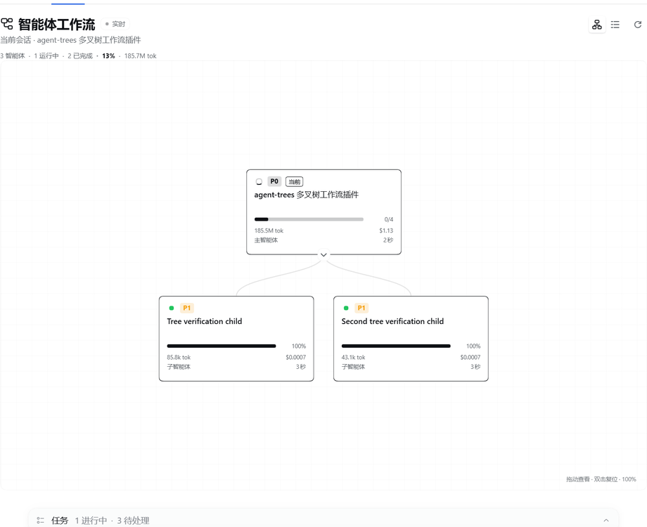
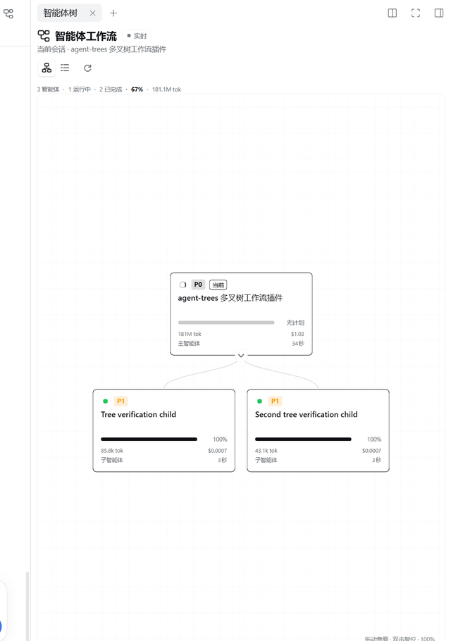

# Agent Trees / 智能体树

**Agent Trees / 智能体树** — a DeepSeek Harness UI plugin that renders the current
session's agent workflow as a live multi-way tree, in a top-down chart layout by
default. It is a standard DSH bundle (`dsh.bundle`) with a Web Client half and no
build step.

**中文简介**：在 DeepSeek Harness 的对话页和右侧边栏中以多叉树展示当前会话的智能体工作流；每个卡片显示状态、计划进度、Token、费用和运行时间。

Each agent is a compact card ("小方块") with a minimal 1px outline:

- the task it owns (the delegation label, or the session title when no label exists),
- a top-left status indicator — a small spinner while running, a green dot on
  success, a red dot on failure, and a grey dot otherwise,
- a `P0`–`P3` priority badge,
- a static progress bar based on its todo plan (no flowing animation),
- a footer with current tokens, USD cost, main/subagent role, and live duration.

The current session is the highlighted card. When the current session is itself a
subagent, the tree walks up to the topmost available parent and marks the current
agent in the family tree.

## Install

The plugin is prepared for the [dsh-market](https://github.com/dsh-market/dsh-market)
catalog through [`awesome-dsh-plugin`](https://github.com/awesome-dsh-plugin/awesome-dsh-plugin).
Once the catalog entry is live, search **Agent Trees / 智能体树** in
**Settings → Plugin Market**.

You can install it directly from the repository now:

```sh
dsh plugin --profile web add github:xiezouqu12/agent-trees
```

On DSH Desktop, install from **Settings → Plugins** (the desktop app owns its
profile, so the CLI does not change the running app's profile).

Repository: [xiezouqu12/agent-trees](https://github.com/xiezouqu12/agent-trees).
Requires DeepSeek Harness `>=0.2.1-rc.1 <0.3.0`.

## Screenshots





## Where it appears

Open a conversation and select the **Agent Trees / 智能体树** tab next to
**Chat**, **Trajectory**, and the other views. The tab is added through the
`conversation.view` Client slot.

It also opens in the **right sidebar**:

- Click the small tree icon in the conversation header (next to the sidebar
  toggle) to open or focus the **Agent Trees** sidebar tab in one click.
- The right sidebar's `+` guide lists an **Agent Trees** capsule, so the tab can
  also be opened from there.
- The sidebar tab is a native `sidebar.right.pane.tab` body with a compact
  layout, and it stays open beside the chat while the session changes.

The sidebar is **not** opened automatically for an ordinary session. It opens
when you click the header tree icon or pick the capsule from the sidebar `+`
guide. A long multi-agent task may auto-open it once after **3+ agents** have had
at least one running for about **25 seconds**, and only while the sidebar is
collapsed; a simple project never triggers it.

### Layouts

The view opens in **Chart** layout: a top-down org chart with rounded cards and
smooth curved connectors on a graph-paper canvas that fills the remaining panel
height (the whole sidebar body in the right-sidebar tab). Drag anywhere on the
canvas background to pan the whole tree; use the mouse wheel to zoom around the
cursor (35%–250%); double-click the background to reset pan and zoom. The canvas
hint shows the current zoom percentage. Each card shows the task, priority,
status, progress, tokens, cost, role, and runtime. Collapse a branch with the
round chevron at the card's bottom edge; the chart reflows immediately.

The two icon buttons in the header switch between **Chart** and **List** (the
indented tree). The same layout applies to the conversation tab and the
right-sidebar tab.

## How the data is derived

The plugin is Client-only and reads existing client-visible session projections —
it writes no session events and registers no Host route:

| Projection | Used for |
| --- | --- |
| `subagentCatalog` | parent → child topology, delegation mode, task label |
| `subagentTiming` | last-turn completion, settled/active duration |
| `tokenUsage` | per-agent token total |
| `costUsage` | per-agent token buckets and USD cost (when `dsh-cost-meter` is mounted) |
| `todos` | per-agent task progress, when the agent used `todo_write` |

Session summaries (`useSessions().byId`) supply titles, running state, `blank`,
and the parent link. `useSessionStatus` supplies the live status map.

### Progress rules

1. If the agent has a todo list, progress is
   `(completed + 0.5 × in_progress) / total`, and the card shows `done/total`.
2. A running agent without a todo plan shows a static empty track labelled
   `无计划`; the top-left spinner indicates that it is running. Nothing flows or
   animates.
3. A finished agent whose latest closed turn completed shows 100% and a green
   status dot.
4. A finished agent whose todo list is fully completed is also 100%, even when
   the timing projection has not settled yet.
5. A finished subagent whose latest closed turn did not complete shows a red
   status dot; its bar stays at its actual todo progress, or `无计划` when it had
   no plan.
6. A blank, not-yet-started agent shows 0% and a grey dot.
7. External tasks (`mode: "external"`) have no local session, so their bar is
   neutral and labelled "外部".
8. The **main agent** is never marked red just for being idle between turns: it
   shows a grey idle dot. Red is reserved for a subagent that ended without
   completing. The main agent's todo projection is cleared at each turn start, so
   the card shows `无计划` until a new plan is written; it keeps the last plan it
   observed.

The header's overall percentage follows the main task's todo plan when the root
has one, so a small finished child cannot inflate the main task. When the main
task is running without a todo plan it uses the finished-agent ratio instead;
otherwise it averages the per-agent progress values that are known. The value is
shown inline with the agent counts; hover it for the estimate source.

### Priority rules

- By default priority follows depth: root = `P0`, direct children = `P1`,
  grandchildren = `P2`, deeper = `P3`.
- A delegation label may override it with a leading `[P0]`, `P1:`, `P0 -`, etc.
  prefix; the prefix is removed from the displayed task title.

### Order

Cards no longer display sequence numbers (`#01`, `#02`, …). Siblings keep the
parent catalog's event order, and the tree position itself conveys the workflow
order.

## Interactions

- Click a card to open that agent's conversation (the current card is inert).
- Click the header tree icon to open or focus the right-sidebar tab.
- Drag the canvas background to pan the tree; use the mouse wheel to zoom around
  the cursor; double-click the background to reset pan and zoom.
- Switch between chart and list with the two header layout icons.
- In chart layout, use the round chevron at the bottom of a card to collapse its
  branch; in list layout, use the chevron at the left of the row.
- The refresh icon re-reads projections for every visible agent.
- The header keeps a compact one-line summary: agents, running, done, overall
  percentage, and token total. There is no separate progress card, search bar,
  filter row, or legend taking up tree space.
- Keyboard: `ArrowUp` / `ArrowDown` move between cards, `ArrowRight` /
  `ArrowLeft` expand or collapse, `Home` / `End` jump to the ends, `Enter` /
  `Space` opens.

Projection updates arrive through the normal Client store, so topology, status,
todos, duration, and token counts update live. A one-second clock refreshes
durations while any agent runs.

## Compatibility

Built and tested against DeepSeek Harness `0.2.1-rc.2` (the version in this
desktop install). The package declares `engines.dsh: >=0.2.1-rc.1 <0.3.0`.
It depends only on the Web Client slot surface and the standard session hooks:

- `conversation.view` slot with `sessionId`, `useSessions`, `useSessionStatus`
- `ctx.sessions.refreshProjections`
- `ctx.uiWorkspace.openSession`
- `ctx.locale` and `ctx.slots`

No Harness Client package is imported as a module; React comes from the browser
module table.

## Files

| File | Purpose |
| --- | --- |
| `index.js` | Host half (metadata only) |
| `client.js` | Browser module: view, tree, cards, styles, locale dictionaries |
| `cordis.patch.yml` | Inserts the `agent-trees` row |
| `locale/en.json`, `locale/zh.json` | Plugin Manager display metadata |
| `icon.svg` | Original artwork |
| `screenshot-main.png`, `screenshot-sidebar.png` | Marketplace screenshots |
| `screenshots.json` | dsh-market screenshot manifest |
| `marketplace/agent-trees.yml` | Entry submitted to the awesome-dsh-plugin catalog |
| `LICENSE` | MIT |

## Notes and limits

- The tree reflects what the Client projection store knows. An agent that is not
  reachable through a parent's `subagentCatalog` (for example an external task
  without a parent-owned catalog fact) cannot be shown as a local child.
- External tasks have no local execution status; they are displayed as leaves.
- When a running agent has no todo list, the bar is a static empty track labelled
  `无计划`; the card never invents a percentage.
- The plugin does not mark the main session as "completed" merely because it is
  idle; completion always follows the last closed turn or an all-completed todo
  list.

## Development

The plugin has no build step. Edit `client.js` (a browser module registered
through `window.__ModuleLoader__`) and let DSH HMR reload it, or reload the page.
Run `node --check client.js` for a syntax check. The host half `index.js` is a
no-op metadata module; the bundle patch inserts the client row.

## License

MIT © 2026 xiezouqu12. See [LICENSE](LICENSE).
